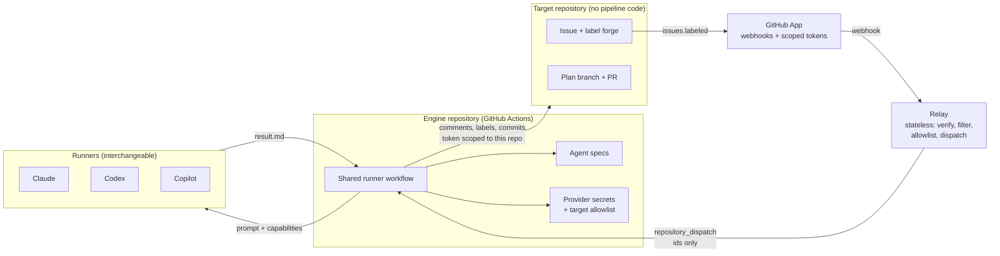
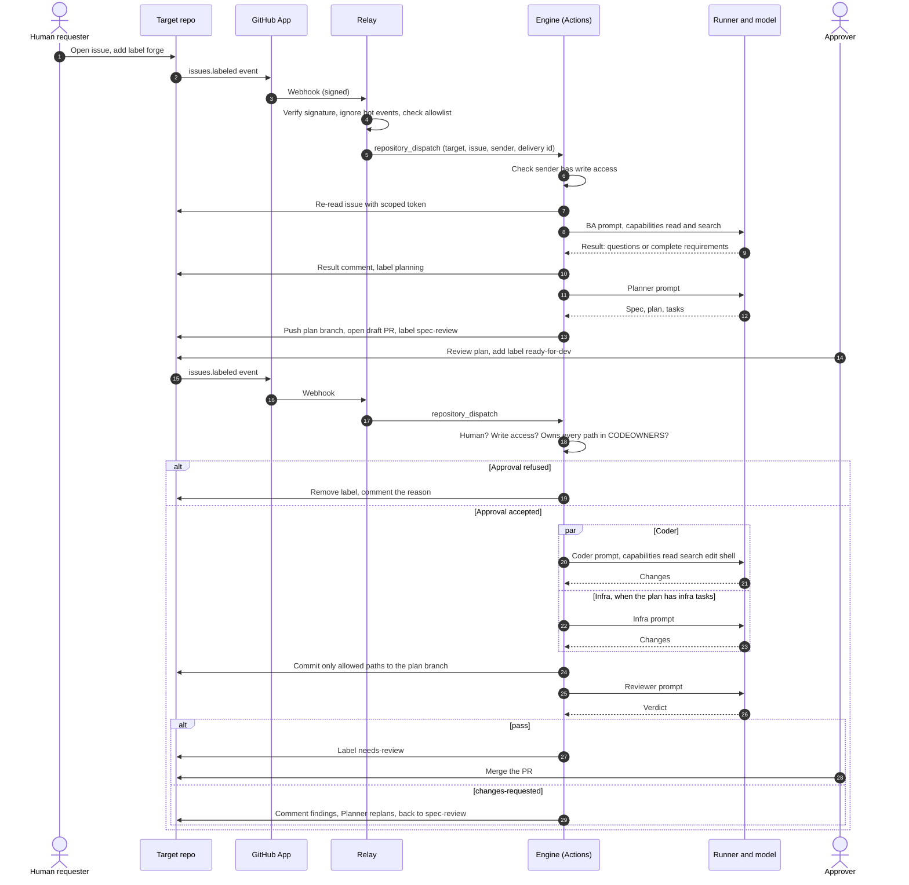
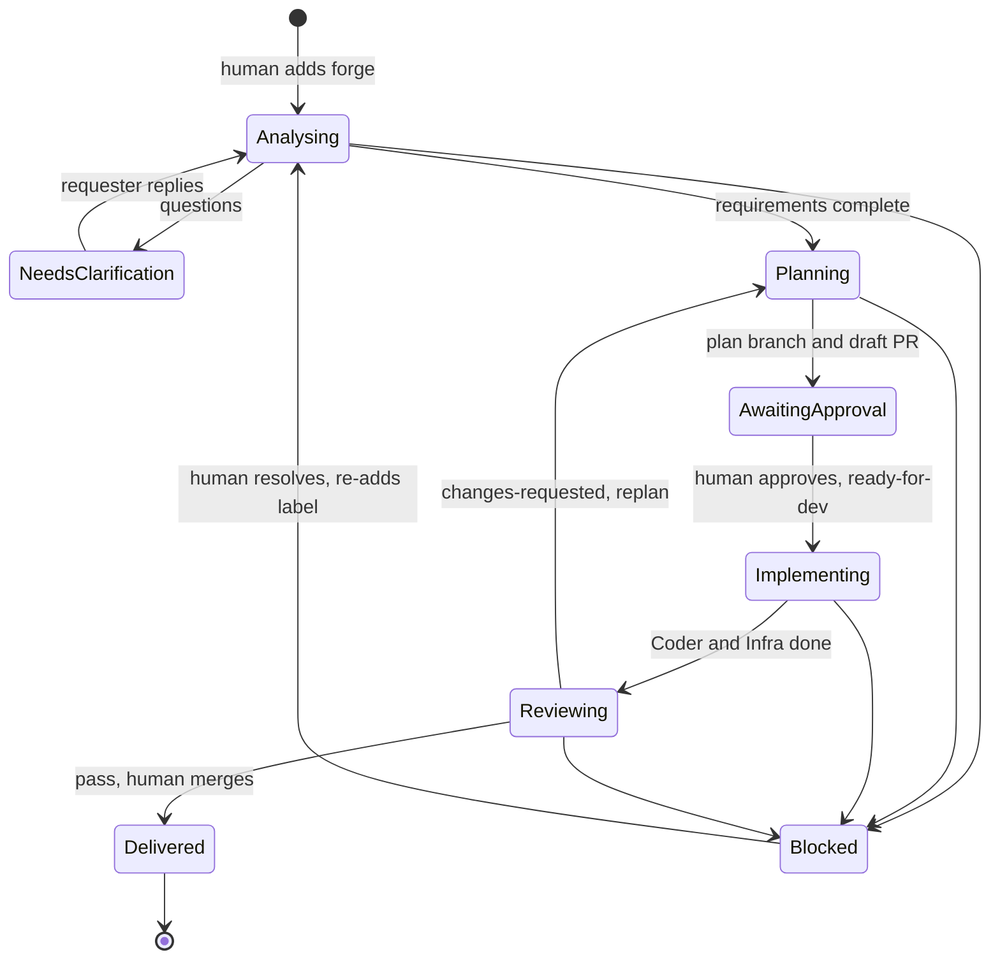

# Agentic Forge

A **central, model-agnostic engine** for agentic development workflows. In any of your repositories you open an
issue describing what to build and label it `forge`. The engine analyses, plans, asks for human approval,
implements and reviews, then delivers a pull request in that same repository. The model doing the work is
replaceable: Claude, Codex (ChatGPT) or GitHub Copilot.

> **Status:** documentation phase. No code exists yet. See the [roadmap](docs/roadmap.md).

Full documentation lives in [docs/](docs/README.md). Decisions are recorded in the [ADRs](docs/decisions/).

# How it works

Three views of the same system: the components, one request end to end, and the request's states.

## 1. Components

## 2. One request, end to end

## 3. Request states

## What each side may do

| | Human | Agent | Engine workflow |
|---|---|---|---|
| Start a request | Yes (write access) | No | Verifies |
| Approve implementation | Yes (write access, plus CODEOWNERS when present) | **Never** | Verifies, can refuse |
| Read the issue and repo | Yes | Only data it is handed | Yes, with a scoped token |
| Comment, label, push, open PR | Yes | **No GitHub access** | Yes, only from the agent's result and an allowlist |
| Merge | Yes | **Never** | **Never** |

# Architecture

The engine lives in **one central repository** and runs on GitHub Actions. A request is an issue in a **target
repository**; its state is that issue's labels and result comments. Work is delivered as a pull request in the
same target. The diagrams above show the flow; this section defines the parts.

## Building blocks

| Component | Responsibility |
|---|---|
| **GitHub App** | Installed on targets; delivers events; supplies short-lived, repo-scoped tokens |
| **Relay** | Verifies, filters, checks the allowlist and dispatches ([ADR-0007](docs/decisions/0007-webhook-relay.md)) |
| **Engine repo** | Workflows, agent specs, provider secrets, the allowlist |
| **Target repo** | The issue, the plan branch, the PR. Contains no pipeline code |

## Roles

| Agent | Starts on | Produces |
|---|---|---|
| **BA** | Label `forge` | Clarifying questions, then complete requirements |
| **Planner** | Label `planning` | Spec, plan and tasks on a plan branch in the target, plus a draft PR |
| **Coder** | Orchestrator | Implementation of application tasks |
| **Infra** | Orchestrator | Implementation of infrastructure tasks |
| **Reviewer** | Orchestrator | Verdict: `pass`, `changes-requested` or `blocked`. Never approves or merges |

The loop ends only when the Reviewer passes and a human merges, or when a human stops approving another pass.
There is no iteration counter; the human gate is the brake.

## Labels

Labels live on the request issue, in the target.

| Label | Meaning | Added by |
|---|---|---|
| `forge` | Creates the request and starts BA | Human |
| `forge:claude`, `forge:codex`, `forge:copilot` | Choose the provider | Human |
| `needs-clarification` | An agent needs input from the requester | Engine |
| `planning` | Starts Planner | Engine |
| `spec-review` | Plan awaits human review | Engine |
| `ready-for-dev` | **Human approval.** Starts the orchestrator | **Human only** |
| `needs-review` | Reviewer passed; a human decides the merge | Engine |
| `blocked` | An agent could not proceed | Engine |

`ready-for-dev` is honoured only when added by a human with write access who, if the target has a `CODEOWNERS`
file, owns every path the plan changes ([ADR-0008](docs/decisions/0008-approval-authority.md)). Events caused by
the App's own bot never count as approval (see [security and governance](docs/security-and-governance.md)). If
the approval is refused, the engine removes the label and comments with the reason.

## Shared runner workflow

One reusable workflow runs every agent. It receives the dispatch (target, issue number, sender, delivery id) and:

1. Resolves and validates the **target** against the allowlist, and checks the sender's permission.
2. Mints a short-lived, repo-scoped token and checks out the target and the plan branch
   ([target repositories](docs/target-repositories.md)).
3. Re-reads the issue and PR data itself. The dispatch payload is never used as content.
4. Loads the agent's [spec](docs/agent-spec.md) and the target's `.forge/config.yml`, applying only restrictions.
5. Builds the prompt: task instructions, runtime rules, then the request data.
6. **Invokes the selected runner**, the only provider-specific step ([runner contract](docs/runner-contract.md)).
7. Posts the agent's final message on the issue, starting with its result marker.
8. Applies labels and status from the result, restricted to an allowlist.
9. For writing agents, commits only the allowed paths to the plan branch and, for the Planner, opens the draft PR.

## Result protocol

Each agent ends with a comment beginning `<!-- <agent>:result -->` followed by a YAML block (`status`, and
agent-specific fields such as `branch`, `pr`, `verdict`). The orchestrator reads these comments to decide what
runs next. Only comments authored by the engine's App bot are trusted.

## Concurrency

One orchestration per request, grouped by `target#issue`. A second event for the same request waits and never
races the first. Different requests run in parallel, each isolated.

## Idempotency and redelivery

Webhooks may be redelivered. Every stage first checks the current labels and result comments, and does nothing
if its work is already done.

## State and recovery

State is labels, result comments, the plan branch and the PR. If a run fails, a human re-adds the trigger
label. This is acceptable at the current scale and is the main limitation addressed by
[ADR-0004](docs/decisions/0004-runtime-as-future-engine.md).
