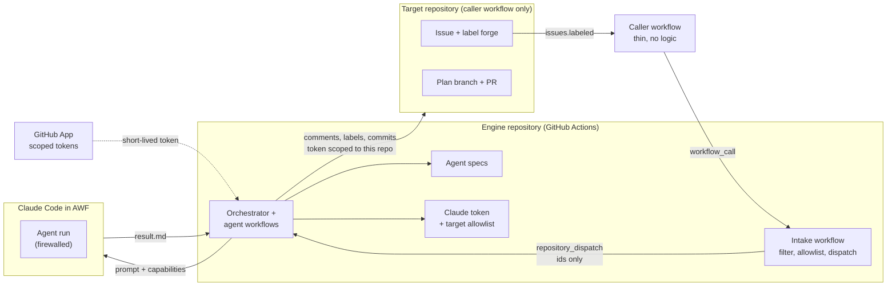
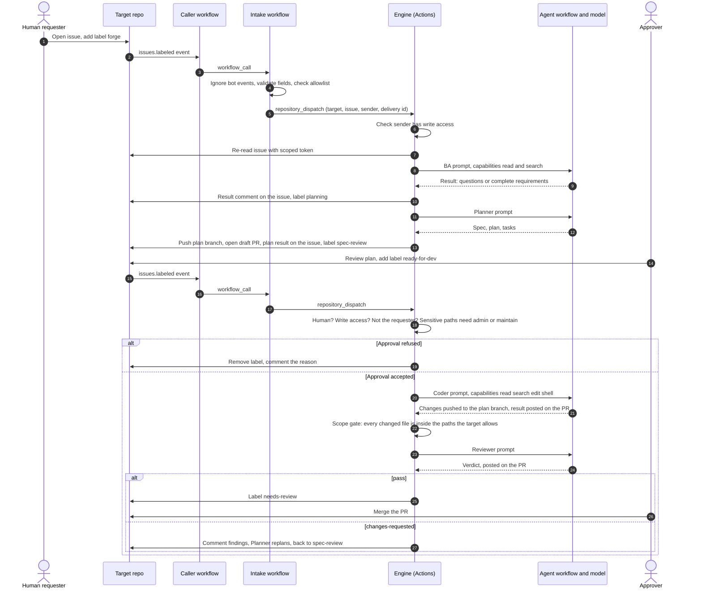
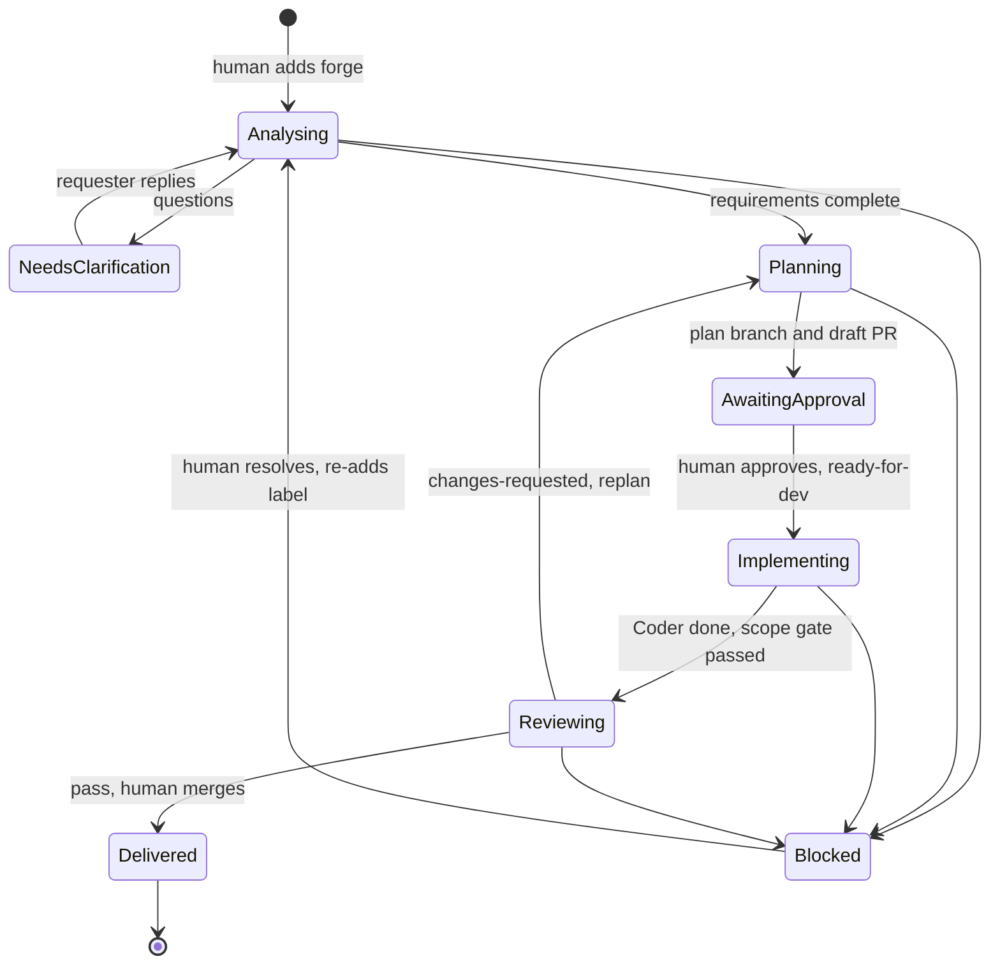

# Agentic Forge

A **central engine** for agentic development workflows. In any of your repositories you open an
issue describing what to build and label it `forge`. The engine analyses, plans, asks for human approval,
implements and reviews, then delivers a pull request in that same repository. The agents run on Claude Code, inside a
firewall ([ADR-0022](docs/decisions/0022-all-agents-on-claude-in-awf.md), [ADR-0024](docs/decisions/0024-claude-code-only.md)).

> **Status:** Phase 1. The pipeline ran end to end on a sandbox repository (BA, Planner, human approval, Coder,
> Reviewer). See the [roadmap](docs/roadmap.md) for what is verified and what is not.
>
> **Live status:** <https://luisiitodev.github.io/agentic-forge/> shows every request and the state of each agent
> (see [Status page](#status-page)).

Full documentation lives in [docs/](docs/README.md). Decisions are recorded in the [ADRs](docs/decisions/).

# How it works

Three views of the same system: the components, one request end to end, and the request's states.

## 1. Components



## 2. One request, end to end



## 3. Request states



## What each side may do

| | Human | Agent | Engine workflow |
|---|---|---|---|
| Start a request | Yes (write access) | No | Verifies |
| Approve implementation | Yes (write access, not the requester, admin or maintain for sensitive paths) | **Never** | Verifies, can refuse |
| Read the issue and repo | Yes | Only data it is handed | Yes, with a scoped token |
| Comment, label, push, open PR | Yes | **No GitHub access** | Yes, only from the agent's result and an allowlist |
| Merge | Yes | **Never** | **Never** |

# Architecture

The engine lives in **one central repository** and runs on GitHub Actions. A request is an issue in a **target
repository**; its state is that issue's labels and result comments. Work is delivered as a pull request in the
same target. The diagrams above show the flow; this section defines the parts.

## Building blocks

| Component | Responsibility |
|---|---|
| **GitHub App** | Installed on targets; supplies short-lived, repo-scoped tokens |
| **Caller workflow** | A thin file in each target that passes the event to the engine ([ADR-0015](docs/decisions/0015-reusable-workflow-intake.md)) |
| **Intake workflow** | In the engine: filters, checks the allowlist and dispatches ([ADR-0015](docs/decisions/0015-reusable-workflow-intake.md)) |
| **Engine repo** | Workflows, agent specs, provider secrets, the allowlist |
| **Target repo** | The issue, the plan branch, the PR. Contains only the caller workflow, no pipeline logic |

## Roles

| Agent | Starts on | Produces |
|---|---|---|
| **BA** | Label `forge` | Clarifying questions, then complete requirements |
| **Planner** | Label `planning` | Spec, plan and tasks on a plan branch in the target, plus a draft PR |
| **Coder** | Orchestrator, after approval | Implementation of application tasks |
| **Reviewer** | Orchestrator | Verdict: `pass`, `changes-requested` or `blocked`. Never approves or merges |

The loop ends only when the Reviewer passes and a human merges, or when a human stops approving another pass.
There is no iteration counter; the human gate is the brake.

## Labels

Labels live on the request issue, in the target.

| Label | Meaning | Added by |
|---|---|---|
| `forge` | Creates the request and starts BA | Human |
| `needs-clarification` | An agent needs input from the requester | Engine |
| `planning` | The Planner is working, or replanning after review | Engine |
| `spec-review` | Plan awaits human review | Engine |
| `ready-for-dev` | **Human approval.** Starts implementation | **Human only** |
| `needs-review` | Reviewer passed; a human decides the merge | Engine |
| `blocked` | An agent could not proceed | Engine |

`ready-for-dev` is honoured only when added by a human with write access ([ADR-0011](docs/decisions/0011-approval-by-write-access.md)),
who did not open the request, and who has the admin or maintain role if the plan touches a sensitive path
([ADR-0012](docs/decisions/0012-approval-policy.md)). Events caused by the App's own bot never count as approval (see [security and governance](docs/security-and-governance.md)). If
the approval is refused, the engine removes the label and comments with the reason.

## Workflows

Two kinds of workflow run a request: the agent workflows and the orchestrator. `forge-intake` receives the events
from the targets ([ADR-0015](docs/decisions/0015-reusable-workflow-intake.md)); `forge-preflight` and `forge-dashboard`
are tools around the pipeline ([Preflight](#preflight), [Status page](#status-page)).

**Agent workflows** (`.github/workflows/forge-<agent>-claude.yml`, one per agent, all calling
`forge-agent-claude.yml`) run one agent each, on Claude Code inside AWF, the firewall of GitHub's agentic workflows
([ADR-0022](docs/decisions/0022-all-agents-on-claude-in-awf.md)). The prompt is the spec from
`.github/forge/agents/<agent>.md`. Every one takes `target`, `issue` and `thread` as inputs (and `pr` and `ref` after the
plan exists), so the repository, the request and where it posts are fixed by the dispatch, never chosen by the agent.
Each run has two jobs:

1. **agent**: checks out the target at `target/` with a short-lived, read-only, repo-scoped App token, reads the request
   into files, and runs Claude Code behind a network allowlist. The agent has no write access to GitHub. What it changed
   is collected as a patch.
2. **deliver**: the only job that writes. It validates the result and the changes (paths, plan pull request), scans
   both for credentials, then comments, opens or updates the draft PR, or pushes to the plan branch, with a separate
   token (see [Defenses against prompt injection](#defenses-against-prompt-injection)).

**Orchestrator** (`.github/workflows/forge-orchestrator.yml` and `.github/forge/orchestrate.py`) is plain,
deterministic Actions code. No model runs in it. It:

1. Validates the event and checks the target against the allowlist **before** any credential exists.
2. For a human event: checks the sender is a human with write access, then starts BA, approves, or resumes.
3. Dispatches the agent workflow and **waits for that run in the same job** ([ADR-0018](docs/decisions/0018-orchestrator-awaits-agent-runs.md)),
   then reads its result and applies the transition below, until a human gate or a failure ends the chain. It sets the
   labels. Agents never do. One orchestration runs at most `FORGE_MAX_STAGES` agent runs (default 12).

| Agent result | Orchestrator action |
|---|---|
| `ba` `complete` | Label `planning`, run the Planner |
| `ba` or `planner` `needs-clarification` | Label `needs-clarification`; a human reply resumes that agent |
| `planner` `ready-for-review` | Require the plan PR, label `spec-review`, clear any earlier approval |
| `ready-for-dev` by an authorized human | Run the Coder. A plan that still lists infrastructure tasks is refused: the engine has no infrastructure agent ([ADR-0023](docs/decisions/0023-no-infra-agent.md)) |
| `coder` `ready-for-review` | The scope gate |
| Scope gate passed | Run the Reviewer |
| Scope gate failed | Label `blocked`, list the files outside the allowed paths |
| `reviewer` `pass` | Label `needs-review` |
| `reviewer` `changes-requested` | Clear approval, label `planning`, run the Planner on the same PR |
| any `blocked`, a failed run, or no result | Label `blocked` and comment the reason |

The **scope gate** compares every file changed on the plan branch with the paths the target declares
(`paths.app` in `.forge/config.yml`) and the plan directory. Without a config nothing is allowed.

### Configuration

| Name | Kind | Meaning |
|---|---|---|
| `FORGE_APP_ID` | variable | Client id of the GitHub App installed on targets |
| `FORGE_APP_KEY` | secret | The App's private key. The most sensitive secret in the engine |
| `FORGE_ALLOWED_TARGETS` | variable | Targets the engine may serve (`owner/name`, comma or newline separated) |
| `FORGE_BOT_LOGIN` | variable | Login of the App's bot. Only its comments are trusted as results |
| `FORGE_ALLOW_SELF_APPROVAL` | variable, optional | `true` lets whoever opened a request approve its plan. Default: off |
| `FORGE_SENSITIVE_PATHS` | variable, optional | Path prefixes (comma or newline separated). A plan that touches one needs an approver with the admin or maintain role |
| `CLAUDE_CODE_OAUTH_TOKEN` | secret | The OAuth token of `claude setup-token`. Every agent runs on it, inside AWF ([ADR-0022](docs/decisions/0022-all-agents-on-claude-in-awf.md)) |
| `FORGE_MODEL_BA`, `FORGE_MODEL_PLANNER`, `FORGE_MODEL_CODER`, `FORGE_MODEL_REVIEWER` | variables, optional | Pin an agent to `haiku`, `sonnet` or `opus`, over the router. An unknown value fails the run ([ADR-0027](docs/decisions/0027-model-router.md)) |

### Models

Each agent runs on the Claude model a deterministic table picks (`.github/forge/claude/choose_model.py`,
[ADR-0027](docs/decisions/0027-model-router.md)). No model takes part in the choice, and only the engine's own data
counts (trusted results, the plan, the PR), never text the requester wrote.

| Agent | Base | Moves to Opus when |
|---|---|---|
| BA | Haiku | Never |
| Planner | Sonnet | It replans after the Reviewer asked for changes |
| Coder | Sonnet | The plan has 6 or more application tasks, touches a sensitive path, or is a replan |
| Reviewer | Sonnet | The plan touches a sensitive path |

### Defenses against prompt injection

The prompt tells the agent that the request is data, but that is the attacker's channel too. The defenses that hold
are deterministic (`.github/forge/claude/guard.py`, [ADR-0026](docs/decisions/0026-prompt-injection-defenses.md)):

- **Before the agent reads:** HTML comments and invisible or bidirectional characters are removed from the issue, the
  PR and every comment.
- **Before anything is published:** the result and the patch are scanned for credentials; a hit publishes nothing.
  Images, HTML and `@mentions` that could leak data or notify strangers are neutralized in the posted comment.
- **For the human reviewer:** changes to dependencies, builds, CI or scripts are listed under *Files to review closely*.
- **Narrow tools:** each agent gets only its tools, turn limit and network allowlist (`configure_agent.py`).

### Preflight

`forge-preflight` (Actions tab, run by hand with the target as `owner/name`) checks the engine's configuration and
access to one target. It only reads, prints no secret and writes a table of what to fix in the run summary. Run it
before the first request on a new target ([first-run checklist](docs/first-run-checklist.md)).

### Status page

`forge-dashboard` publishes `site/` to GitHub Pages: <https://luisiitodev.github.io/agentic-forge/>. One card per
request with the state of BA, Planner, Coder and Reviewer, a link to each run and to the issue.

- Data: `.github/forge/dashboard/build_status.py` reads the runs of the `forge-*-claude` workflows with `gh` and writes
  `site/data/runs.json`. It reflects GitHub Actions only, no model runs in it. A request shows *Esperando humano* when
  the Reviewer passed; the merge itself is not tracked.
- Refresh: every 15 minutes, on a push to `main` that changes `site/` or the script, or by hand. The page reloads
  the data every minute.
- Setup: Settings → Pages → Source = **GitHub Actions**.

### Working on the workflows

```bash
python3 .github/forge/tests/run.py          # orchestrator, scripts and workflow checks; no GitHub needed
```

## Result protocol

The issue is the request; the plan pull request is the working surface ([ADR-0010](docs/decisions/0010-shared-plan-pr.md)).
BA, which runs before the PR exists, and the first plan result are posted on the **issue**. Replans and the
Coder and Reviewer results are posted on the **PR**. The orchestrator reads both.

Each agent ends with a comment whose first line is `## <Agent> result: <status>` (for example `## BA result: complete`), followed by a YAML block (`status`, and
agent-specific fields such as `branch`, `pr`, `verdict`). The orchestrator reads these comments to decide what
runs next. Only comments authored by the engine's App bot (`FORGE_BOT_LOGIN`) are trusted.

## Concurrency

One orchestration per request, grouped by `target#issue`. A second event for the same request waits and never
races the first. Different requests run in parallel, each isolated.

## Idempotency and repeated events

The same event can arrive twice: an intake run re-run by hand, or a label removed and added again. Every stage
first checks the current labels and result comments, and does nothing if its work is already done.

## State and recovery

State is labels, result comments, the plan branch and the PR. If a run fails, a human re-adds the trigger
label. This is acceptable at the current scale; a service with durable state is not planned
([ADR-0025](docs/decisions/0025-scope-claude-only.md)).
