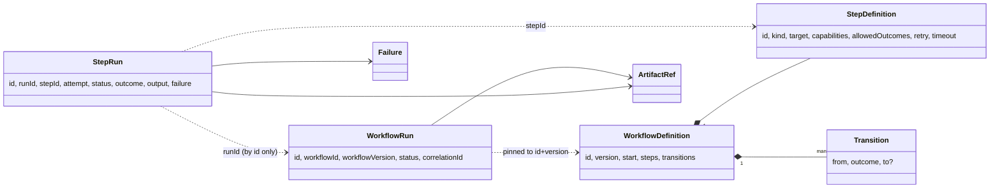
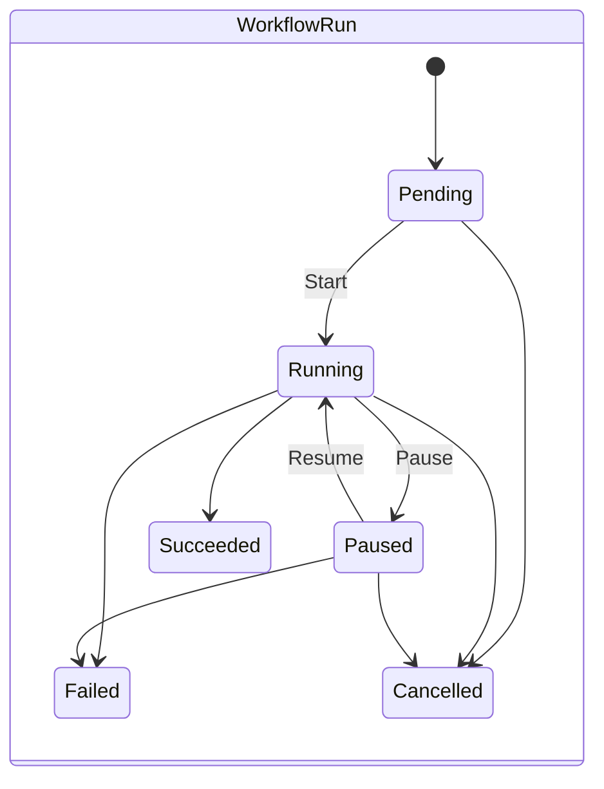
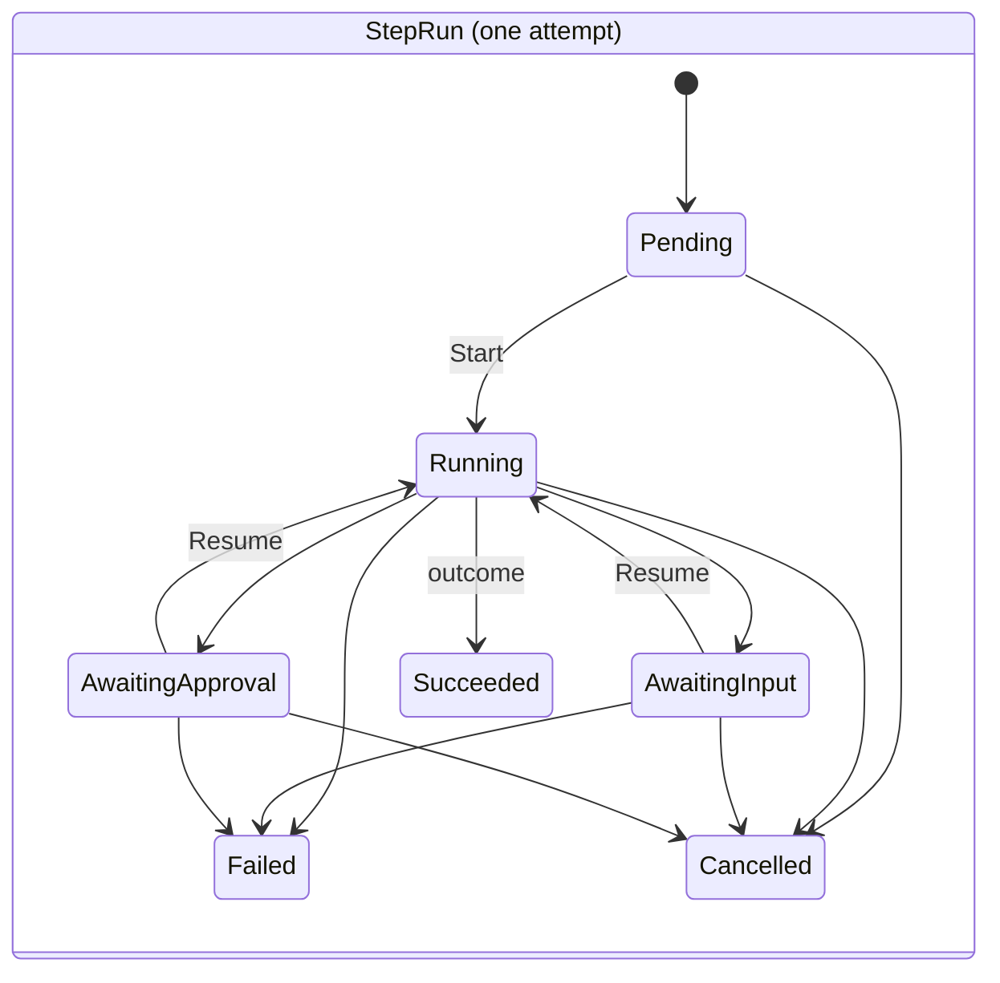
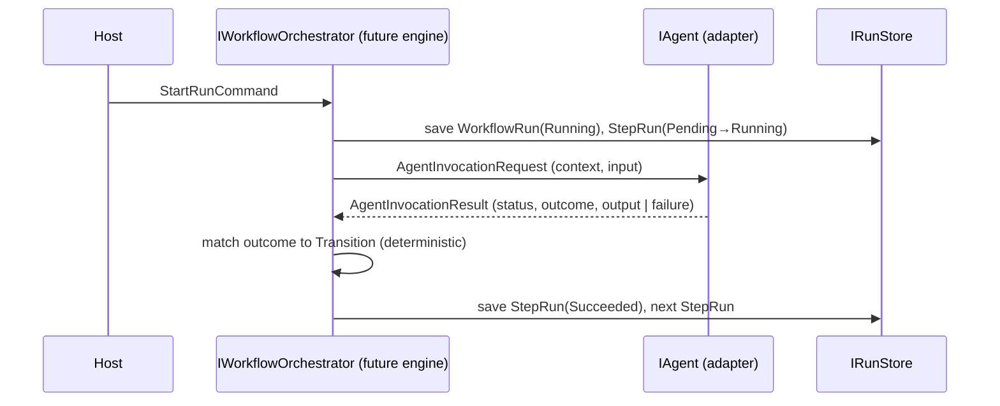

# Domain model and public contracts (issue #5)

Sources of truth: `docs/vision.md`, `docs/scope.md`, `docs/architecture/current-state.md`,
`docs/architecture/extraction-map.md` (stage 1, "Contracts"). Code lives in `src/`; examples in
[`examples/`](examples) are exercised by tests.

## 1. Design in brief

* Three projects, one-way dependencies: `Abstractions → Domain ← Application`. `Domain` has **no** package
  or project references, so it cannot reference a vendor, SDK, or persistence technology.
* **Definition** (what should happen) is data: `WorkflowDefinition`. **Execution records** (what happened)
  are `WorkflowRun` and `StepRun`. **Work** is done by ports (`IAgent`, `IToolProvider`). **Orchestration**
  (what runs next) belongs to a future engine behind `IWorkflowOrchestrator`. No contract mixes these.
* Lifecycle objects (`WorkflowRun`, `StepRun`) are small state machines over an immutable, JSON-serializable
  `*Snapshot` record. Time is passed in (`now`), never read from a clock, to keep orchestration deterministic.
* No engine, persistence adapter, governance engine, or provider is implemented here.

## 2. Diagrams

Retry = a **new** `StepRun` with `attempt + 1`; a failed attempt stays as audit history. Terminal states are final.

## 3. Contract placement and justification

| Contract | Project | Public? | Why |
| --- | --- | --- | --- |
| Identifiers, `WorkflowVersion` | Domain | yes | Shared vocabulary in every record and example |
| `WorkflowDefinition`, `StepDefinition`, `Transition`, `RetryPolicy` | Domain | yes | Pure data; validated without any runtime |
| `WorkflowRun`, `StepRun` + snapshots | Domain | yes | Business invariants (legal transitions) with no I/O; snapshots are the persistence format |
| `Failure`, `ArtifactRef`, `Correlation`, `ApprovalDecision` | Domain | yes | Stored in run records and carried across every port |
| `IAgent`, `AgentDescriptor`, request/result, `StepExecutionContext` | Abstractions | **yes (extension point)** | Implemented by adapters; the one place agent implementations plug in |
| `IToolProvider`, `ToolDescriptor`, request/result | Abstractions | **yes (extension point)** | Same, for tools |
| `IWorkflowOrchestrator`, commands | Application | yes (consumer-facing, not implemented by adapters) | Host entry point; engine internals stay internal |
| `IRunStore`, `IRunRecovery`, `IWorkflowCatalog` | Application | yes (extension points) | Persistence/definition-source ports; they speak in Domain snapshots, so no storage type leaks |

Why `IRunStore` is in Application rather than Abstractions: it is a driven port of the orchestrator, defined in
terms of Domain snapshots, not something agent authors implement. Abstractions is kept to what *agent and tool
authors* reference, so they do not take a dependency on orchestration.

**Deliberately not public (yet):** the scheduler/engine, retry executor, policy evaluation, event bus, and
state-transition coordinator are internal to the future engine. **Deferred ports** (no contract until a use
exists, per scope "avoid premature extension points"): LLM provider (it sits *behind* an agent implementation,
and `IAgent` already covers "typed task context in, result out"), execution provider (cancel/monitor remote
work, needed by stage 3), approval-identity/auth, notification, and event/log sinks. `ApprovalDecision` exists
as data because the run record requires it (scope principle 4).

## 4. Acceptance criteria mapping

| Criterion | How it is met |
| --- | --- |
| No vendor types | Domain has zero references; Abstractions/Application reference only Domain and BCL (`System.Text.Json.JsonElement` for opaque payloads) |
| Invocation ≠ orchestration | `IAgent` performs one unit of work and returns an `outcome`; only the orchestrator maps outcomes to `Transition`s. Agents cannot choose next steps; `AllowedOutcomes` rejects invented ones |
| WorkflowRun ≠ StepRun | Separate types, statuses, state machines, and snapshots; `StepRun` holds only `runId` |
| Explicit I/O, failure, cancellation | `Input`/`Output` as JSON; `Failure` (kind, code, retryable); `InvocationStatus` has `Cancelled` and `NeedsInput`, separate from `Failed`; `Cancel` on runs/steps is distinct from `Fail` |
| Testable without LLM/account | `tests/` use a scripted agent and echo tool; `dotnet test AgenticForge.slnx` runs the whole suite (45 at the time of writing; see the PR for the current result), no network |
| Public vs internal justified | Section 3 |

## 5. Design decisions and trade-offs

1. **Snapshot + state machine instead of anemic or event-sourced models.** Easy to persist and compare in shadow
   mode (extraction map §3.1); event sourcing was judged premature.
2. **Payloads are `JsonElement`, not generics.** Keeps contracts non-generic and schema-validatable (replaces
   today's regex parsing); costs compile-time typing, which a later typed-helper layer can add.
3. **Outcome string routes transitions** (mirrors the reviewer verdict loop). Cheap and explicit; typed outcomes can
   be layered on later.
4. **Step failure fails the run in v1.** Failure transitions/compensation are not defined; `Transition` has no
   failure route. Flag for the engine issue if the Multiverse "finalize" semantics need it.
5. **Retry is data (`RetryPolicy`), executed by the engine.** Bounded by construction (`MaxAttempts ≥ 1`).
6. **Parallel fan-out/fan-in and join policy are not modeled.** Extraction map lists them as a core candidate, but
   modeling them now would be speculative; add `StepKind`/group later as a minor version change.
7. **Optimistic concurrency** is a store-owned `Revision` on both snapshots (compare-and-set on save); locks are not used. See
   [persistence-and-recovery.md](persistence-and-recovery.md).
8. **Approval is a step kind** whose `StepRun` waits in `AwaitingApproval`.
   - *Where the decision is recorded:* `StepRun.Resume(decision)` requires an `ApprovalDecision` for an
     `AwaitingApproval` step and stores it in `StepRunSnapshot.Approval` (audit trail: approver, decision, time, reason).
     Authorization of the approver is a host concern (deferred auth port).
   - *How resume data is represented:* `ResumeRunCommand(Run, Input?, Decision?)` carries **exactly one** of
     `Input` (for a step in `AwaitingInput`) or `Decision` (for `AwaitingApproval`). The invariant is enforced in the
     constructor (also used by System.Text.Json, so malformed JSON is rejected); properties are get-only so `with`
     cannot bypass it; `WithInput`/`WithDecision` factories make intent explicit. Example: `examples/resume-run-command.json`.
   - *Not implemented:* the handoff from `IWorkflowOrchestrator.ResumeAsync` to the right `StepRun` is engine work
     (out of scope). Today `StepRun.Resume` only accepts a decision; persisting resume `Input` onto the step is
     left to the engine issue.
9. **Ambiguity for the maintainer:** whether workflow `Version` must be strict SemVer and whether "latest"
   resolution (`StartRunCommand.Version == null`) is allowed in production. Implemented as `major.minor.patch`, pinned at start.

## 5a. `WorkflowDefinition.Validate()` rules and deliberate limitations

Checked: duplicate step ids; start step exists; unknown transition endpoints; unreachable steps; per-kind fields
(`Agent`/`Tool` require a non-blank `Target`; `Approval` forbids `Target` and `Capabilities`; unknown `StepKind`);
`Retry.MaxAttempts >= 1`, non-negative `Delay`, positive `Timeout`; blank, whitespace-padded or duplicate
capabilities / allowed outcomes / transition outcomes; duplicate `(From, Outcome)` transitions; transition outcomes
outside a step's `AllowedOutcomes`; allowed outcomes without a transition.

Deliberately *not* enforced (no agreed semantics yet): outcomes are case-sensitive and ordinal; `Tool` and
`Approval` steps may omit `AllowedOutcomes` (their outcome vocabulary is engine-defined; `ToolInvocationResult`
has no outcome); cycles are allowed (review loops); retry on `Approval` steps is not rejected; capability names are
not checked against any registry.

## 6. Examples and how to run the tests

JSON examples: [`examples/`](examples). Run `dotnet test AgenticForge.slnx`.
